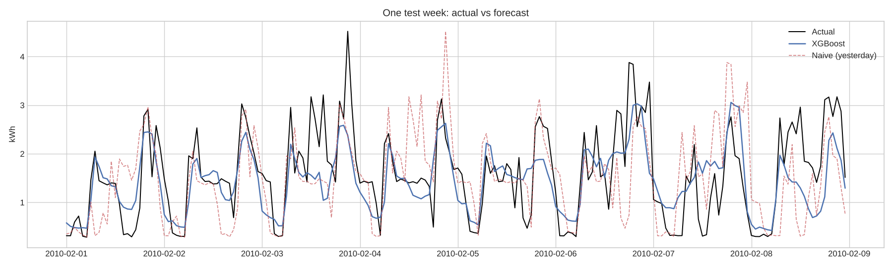

# Day-Ahead Household Energy Forecasting

This project forecasts a household's hourly electricity consumption **24 hours ahead** with XGBoost. The model is tested against seasonal-naive baselines using time-series cross-validation.



## Results

The scores are averages over 5 time-series CV folds covering the final year (Nov 2009 – Nov 2010). Imputed hours are excluded from scoring.

| Model | RMSE (kWh) | MAE (kWh) | RMSE vs best naive |
|---|---|---|---|
| **XGBoost: calendar + lags + holidays** | **0.606** | **0.443** | **−26.8%** |
| XGBoost: calendar + lags | 0.609 | 0.444 | −26.4% |
| XGBoost: calendar only | 0.621 | 0.468 | −24.9% |
| Naive: same hour yesterday | 0.827 | 0.570 | — |
| Naive: same hour last week | 0.838 | 0.583 | +1.2% |

The final model beats the best baseline in all 5 folds.

## Data

[UCI Individual Household Electric Power Consumption](https://www.kaggle.com/datasets/uciml/electric-power-consumption-data-set): 2,075,259 one-minute readings from a single house near Paris, Dec 2006 – Nov 2010.

The CSV (~127 MB) is not included in this repo. Download it and place it at `data/household_power_consumption.csv`.

## Approach

1. **Cleaning.** The data has 1.25% missing minutes, stored as `?`. That includes 6 outages longer than 24 h, the longest about 5 days.
   - Resampled to hourly means, so each value is kWh used in that hour.
   - An hour counts as valid only if at least 45 of its minutes are present.
   - Gaps of 3 h or less are filled by interpolation; longer gaps get the value from the same hour one week earlier.
   - Imputed hours are flagged and never used for scoring.
2. **Features, with no leakage.** The forecast is made at midnight, so every feature uses only data from yesterday or earlier.
   - Calendar: hour, day of week, month, day of year, weekend flag.
   - French public holidays (`holidays` library).
   - Lags: 24 h, 48 h, 168 h, yesterday's mean, and the trailing 7-day mean.
3. **Validation.**
   - `TimeSeriesSplit`: 5 folds of 73 days each.
   - Early stopping on the last 30 days of each training window, never on the test fold.
   - Two seasonal-naive baselines for comparison.

## Findings

- Consumption follows clear daily, weekly, and annual patterns. It peaks in the evenings (20:00–21:00), on weekends, and in winter, and is lowest in August.
- The water heater and A/C circuit accounts for about 35% of total energy. About 51% isn't sub-metered.
- Calendar features alone account for most of the improvement. Lags and holidays add smaller but consistent gains.
- Errors are lowest overnight and highest in the evening, when household behavior is least predictable.

## Limitations and next steps

- **Weather.** There's no temperature data yet, and it's likely the biggest missing driver of winter load.
- **Scope.** This is a single household, so results won't generalize directly to other homes or to grid load.
- **Deployment.** Next step: S3 for data, a scheduled AWS Lambda that writes tomorrow's forecast, and Terraform for the infrastructure.

## Run it

```bash
pip install -r requirements.txt
jupyter notebook energy_forecasting.ipynb
```

## Repo structure

```
energy_forecasting.ipynb   # full analysis, executed with outputs
figures/                   # charts exported by the notebook
models/xgb_day_ahead.json  # trained XGBoost model
data/                      # put the CSV here (not tracked)
tutorial-2023/             # earlier XGBoost forecasting work on PJM grid data
```

## Earlier work

`tutorial-2023/` holds my first time-series forecasting notebook. It forecasts PJM East grid-level demand with XGBoost and follows Rob Mulla's "Time Series Forecasting with XGBoost" tutorial. This project builds on that foundation with a different dataset, real-world data cleaning, leakage-safe day-ahead features, and baseline comparisons.
